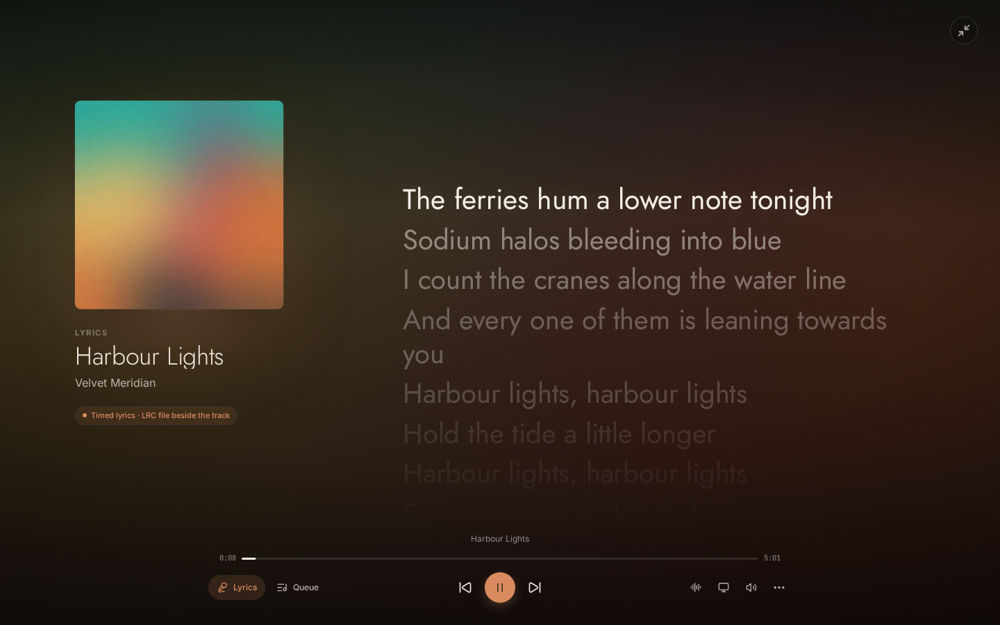

# Mujin Music

Your music. Instantly.

Mujin Music is a local-first music app for your own collection. Based on
[Parson](https://github.com/ParsonLabs/Parson) by ParsonLabs.

Choose a folder. Start listening.


[Download](https://github.com/mavingaw/Mujin-Music/releases) ·
[Docs](apps/site/content/docs) ·
[What Mujin Music adds](docs/mujin-music.md)

## Screenshots

|                                                                                 |                                                                           |
| ------------------------------------------------------------------------------- | ------------------------------------------------------------------------- |
|   |        |
|             |   |
|                     |  |
|  |                |


The six theme presets above are Mujin Dark, Mujin Light, Material You, Frosted
Glass, OLED Black and High Contrast. The library in these captures is a demo
library with generated cover art and fictional artists.

## What Mujin Music adds

Mujin Music takes Parson towards the level of Roon while staying self-hosted
and open source:

- Any format at full quality, including DSD, with a Roon-style signal path,
  quality light, bit-perfect outputs and a server-side DSP engine.
- Zones and grouping across apps, Sonos, UPnP/OpenHome, AirPlay, Chromecast
  and Mujin Bridge DACs.
- Focus filters, endless Radio, credits and works, opt-in online metadata,
  live internet radio, Listen Later, smart tags and listening history.
- TIDAL and Qobuz (with your own API credentials), and playlist import from
  Spotify, Apple Music, YouTube Music and Deezer.
- Profiles, Last.fm and ListenBrainz scrobbling, a Home Assistant
  integration, away-from-home access, backups and library tools.
- Better versions: lossless copies of lossy albums from FETCH, your own
  download manager, and clearly labelled AI-enhanced copies of the rest from
  a self-hosted Apollo enhancer.
- A dark, gallery-style design with timed lyrics, a display mode for TVs and
  tablets, and six theme presets (Mujin Dark and Light, Material You, Frosted
  Glass, OLED Black, High Contrast) with full appearance settings that follow
  your profile to every device.

Read the full write-up, including how it was tested and the known
limitations, in [docs/mujin-music.md](docs/mujin-music.md).

Roon is a trademark of Roon Labs; Mujin Music is not affiliated with or
endorsed by Roon Labs.

## Start

Install Mujin Music, create your account, and choose your music folder.

Desktop apps include everything needed to run your library.

## Download

Get the Windows, macOS, Linux and Android apps and the Windows server from the [Releases page](https://github.com/mavingaw/Mujin-Music/releases).
Android comes as two APKs: `arm64-v8a` for most phones and tablets, `armeabi-v7a` for 32-bit devices.

The server container is `ghcr.io/mavingaw/mujin-music:latest`. Versioned image tags are also published for pinned deployments.

Build provenance (GitHub-built packages) or `SHA256SUMS` checksums (packages built on the project's own machines) are included with each release.

The project can also be hosted and built on a self-hosted Gitea server, with GitHub as a mirror that still builds macOS: see [`deploy/unraid/README.md`](deploy/unraid/README.md) and [`RELEASING.md`](RELEASING.md).

## Docker

```yaml
services:
  parson:
    image: ghcr.io/mavingaw/mujin-music:latest
    network_mode: host
    volumes:
      - /path/to/parson-data:/Parson
      - /path/to/music:/music:ro
    restart: unless-stopped
```

Open `http://localhost:1993`, create your account, and choose `/music`.

## Server and remotes

The Mujin Music server holds your library. Mujin Music Desktop, the Android app, and any browser are remotes for it. Mujin Music Desktop can run the server itself, or be a remote for a server on your NAS or another computer. See [docs/server.md](docs/server.md) for headless installs on Linux, NAS, Docker and Windows, and for how to connect phones.

## Better versions and AI enhance

Library tools → **Better versions** lists albums that are only lossy (or
"lossless" files made from MP3s, found by a spectral check) and asks
**FETCH**, your own download manager, for real lossless copies. Verified
copies play instead; the old copy stays as an alternate version. The
optional **AI enhancer** (`tools/enhancer`, Apollo on your GPU, Windows or
Docker) makes AI-enhanced copies of what FETCH cannot find, and can enhance
lossy tracks live on server zones. AI-enhanced audio is always labelled as
such, never as lossless. See
[docs/better-versions.md](docs/better-versions.md).

## Privacy

Mujin Music does not upload analytics or crash reports.

Music, accounts, playlists, history, and recommendations stay on infrastructure
you control. External requests are limited to services you use, such as
updates, casting, and online metadata (credits, biographies and reviews from
MusicBrainz and Wikipedia, and lyrics from LRCLIB), which is off until an
administrator turns it on. Lyrics in your files (embedded LRC, ID3 SYLT/USLT, or
an `.lrc` file beside the track) are always shown, timed when they carry stamps.
FETCH and the AI enhancer are your own machines on your network; nothing about
them goes to a cloud service.

[Privacy and security](apps/site/content/docs/accounts-privacy-security.mdx)

## Development

Requires Bun, Rust, Node.js, FFmpeg, and the native build toolchain for your
platform.

```sh
bun install --frozen-lockfile
cargo run -p parson-music
```

Run the web app separately:

```sh
bun --filter parson-music-web dev
```

[Development guide](apps/site/content/docs/development.mdx)

## Repository

- `crates/parson-core` — accounts, identities, and libraries
- `crates/backend` — server, indexer, storage, APIs, and discovery
- `apps/web` — web player
- `apps/desktop` — desktop packaging
- `apps/site` — website and docs

## Security

Report vulnerabilities privately through
[GitHub Security Advisories](https://github.com/mavingaw/Mujin-Music/security/advisories/new).

Deployment guidance is in the
[privacy and security documentation](apps/site/content/docs/accounts-privacy-security.mdx).

## License

[GPL-3.0-only](LICENSE)

Mujin Music is based on [Parson](https://github.com/ParsonLabs/Parson) by
ParsonLabs and keeps its GPL-3.0-only licence and copyright notices. The
foundation (library indexing, accounts, server, and the web, desktop and
mobile apps) is their work; see the [credits](docs/mujin-music.md#credits).
Third-party components are listed in the `THIRD_PARTY_NOTICES.md` shipped with
every package, generated by `bun run notices:generate`.
The Mujin Music fonts (Jost, Inter, JetBrains Mono) and the fonts offered in
Settings → Appearance (Fraunces, Atkinson Hyperlegible Next, IBM Plex Sans,
Roboto Flex) are under the SIL Open Font License 1.1; each ships with its
`OFL.txt` in `apps/web/public/fonts`.

Roon is a trademark of Roon Labs; Mujin Music is not affiliated with or
endorsed by Roon Labs.
