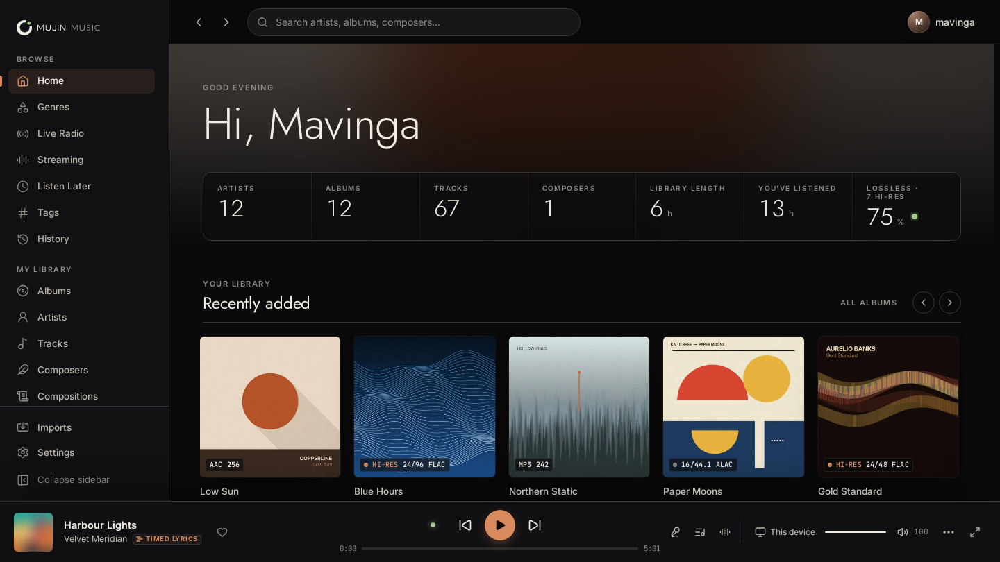

# Mujin Music

Your music. Instantly.

Mujin Music is a local-first music app for your own collection. Based on
[Parson](https://github.com/ParsonLabs/Parson) by ParsonLabs.

Choose a folder. Start listening.



[Download](https://github.com/mavingaw/parson-jin/releases) ·
[Docs](apps/site/content/docs) ·
[What Mujin Music adds](docs/mujin-music.md)

## What Mujin Music adds

Mujin Music takes Parson towards the level of Roon while staying self-hosted
and open source:

- Any format at full quality, including DSD, with a Roon-style signal path,
  quality light, bit-perfect outputs and a server-side DSP engine.
- Zones and grouping across apps, Sonos, UPnP/OpenHome, AirPlay, Chromecast
  and Mujin Bridge DACs.
- Focus filters, endless Radio, credits and works, opt-in online metadata,
  live internet radio, Listen Later, smart tags and listening history.
- TIDAL and Qobuz (with your own API credentials), and playlist import from
  Spotify, Apple Music, YouTube Music and Deezer.
- Profiles, Last.fm and ListenBrainz scrobbling, a Home Assistant
  integration, away-from-home access, backups and library tools.

Read the full write-up, including how it was tested, what is coming next and
the known limitations, in [docs/mujin-music.md](docs/mujin-music.md).

Roon is a trademark of Roon Labs; Mujin Music is not affiliated with or
endorsed by Roon Labs.

## Start

Install Mujin Music, create your account, and choose your music folder.

Desktop apps include everything needed to run your library.

## Download

Get Windows, macOS and Linux packages from the [Releases page](https://github.com/mavingaw/parson-jin/releases).
The Android APK is built by the [Android workflow](.github/workflows/android.yml).

The server container is `ghcr.io/mavingaw/parson-jin:latest`. Versioned image tags are also published for pinned deployments.

Build provenance is included with the release.

## Docker

```yaml
services:
  parson:
    image: ghcr.io/mavingaw/parson-jin:latest
    network_mode: host
    volumes:
      - /path/to/parson-data:/Parson
      - /path/to/music:/music:ro
    restart: unless-stopped
```

Open `http://localhost:1993`, create your account, and choose `/music`.

## Server and remotes

The Mujin Music server holds your library. Mujin Music Desktop, the Android app, and any browser are remotes for it. Mujin Music Desktop can run the server itself, or be a remote for a server on your NAS or another computer. See [docs/server.md](docs/server.md) for headless installs on Linux, NAS, Docker and Windows, and for how to connect phones.

## Privacy

Mujin Music does not upload analytics or crash reports.

Music, accounts, playlists, history, and recommendations stay on infrastructure
you control. External requests are limited to services you use, such as
updates, casting, and online metadata (credits, biographies and reviews from
MusicBrainz and Wikipedia, and lyrics from LRCLIB), which is off until an
administrator turns it on. Lyrics in your files (embedded LRC, ID3 SYLT/USLT, or
an `.lrc` file beside the track) are always shown, timed when they carry stamps.

[Privacy and security](apps/site/content/docs/accounts-privacy-security.mdx)

## Development

Requires Bun, Rust, Node.js, FFmpeg, and the native build toolchain for your
platform.

```sh
bun install --frozen-lockfile
cargo run -p parson-music
```

Run the web app separately:

```sh
bun --filter parson-music-web dev
```

[Development guide](apps/site/content/docs/development.mdx)

## Repository

- `crates/parson-core` — accounts, identities, and libraries
- `crates/backend` — server, indexer, storage, APIs, and discovery
- `apps/web` — web player
- `apps/desktop` — desktop packaging
- `apps/site` — website and docs

## Security

Report vulnerabilities privately through
[GitHub Security Advisories](https://github.com/mavingaw/parson-jin/security/advisories/new).

Deployment guidance is in the
[privacy and security documentation](apps/site/content/docs/accounts-privacy-security.mdx).

## License

[GPL-3.0-only](LICENSE)

Mujin Music is based on [Parson](https://github.com/ParsonLabs/Parson) by
ParsonLabs and keeps its GPL-3.0-only licence and copyright notices. The
foundation (library indexing, accounts, server, and the web, desktop and
mobile apps) is their work; see the [credits](docs/mujin-music.md#credits).
Third-party components are listed in the `THIRD_PARTY_NOTICES.md` shipped with
every package, generated by `bun run notices:generate`.
The Mujin Music fonts (Jost, Inter, JetBrains Mono) and the fonts offered in
Settings → Appearance (Fraunces, Atkinson Hyperlegible Next, IBM Plex Sans,
Roboto Flex) are under the SIL Open Font License 1.1; each ships with its
`OFL.txt` in `apps/web/public/fonts`.

Roon is a trademark of Roon Labs; Mujin Music is not affiliated with or
endorsed by Roon Labs.
