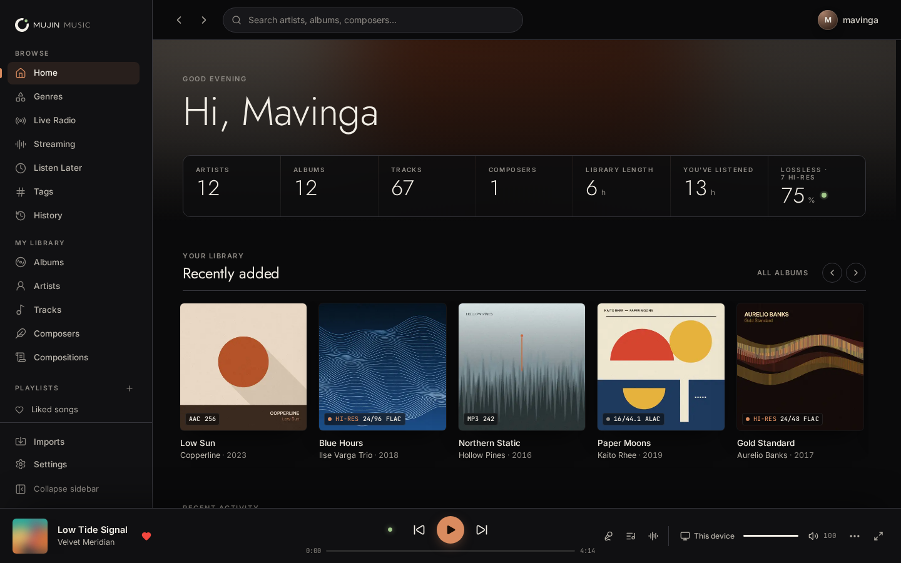
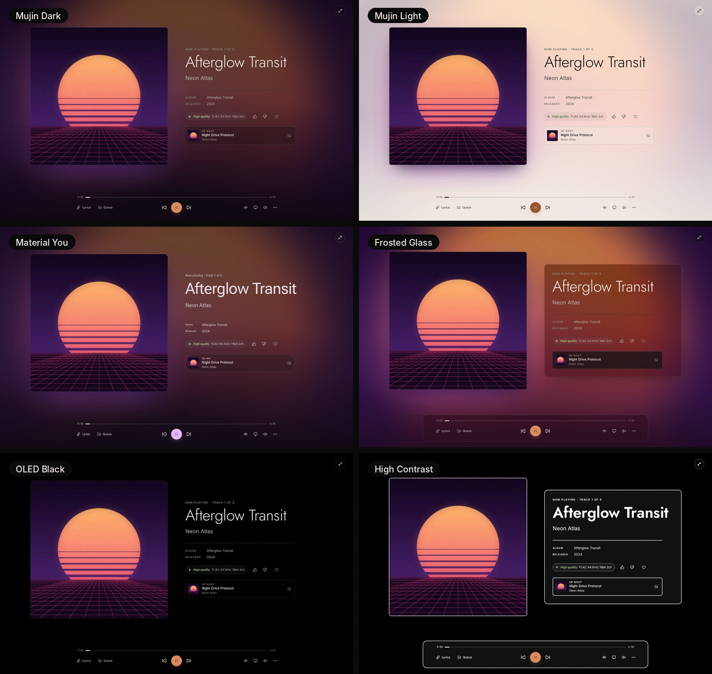
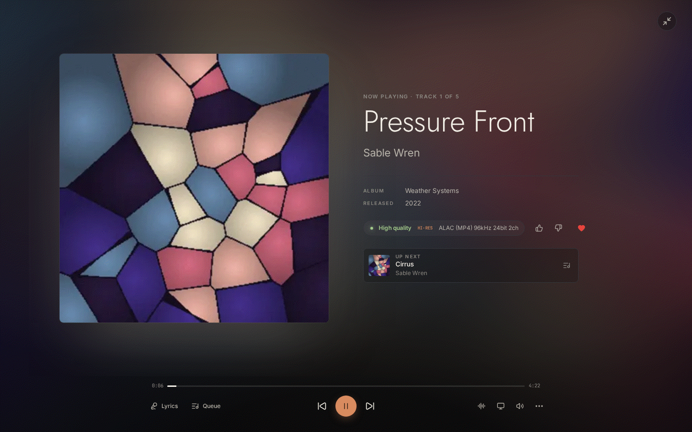
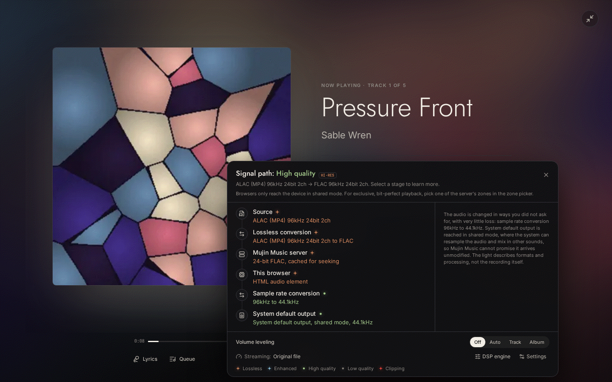
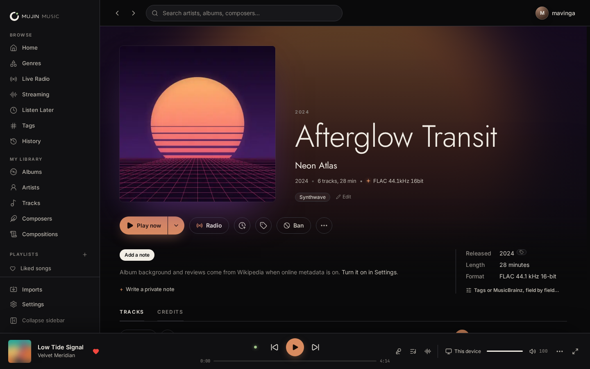
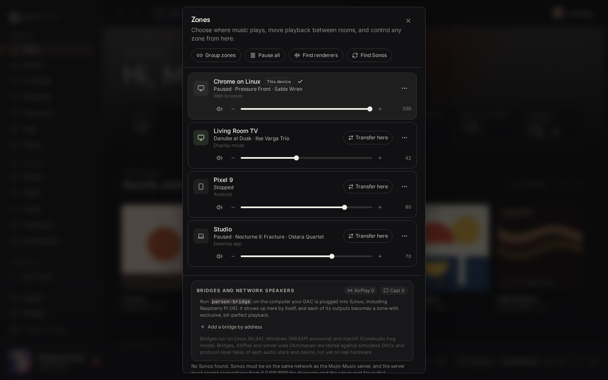
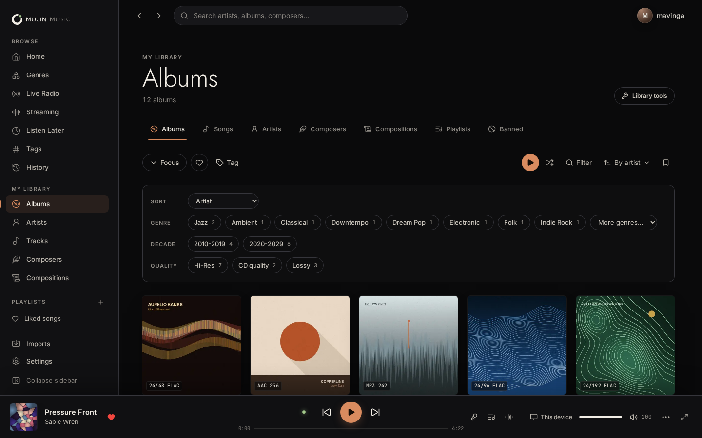
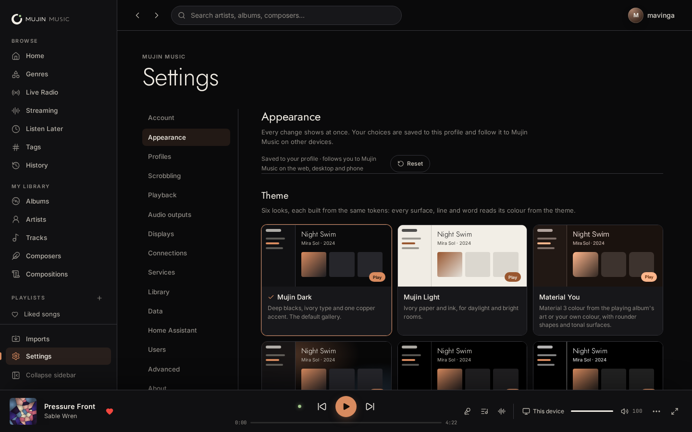
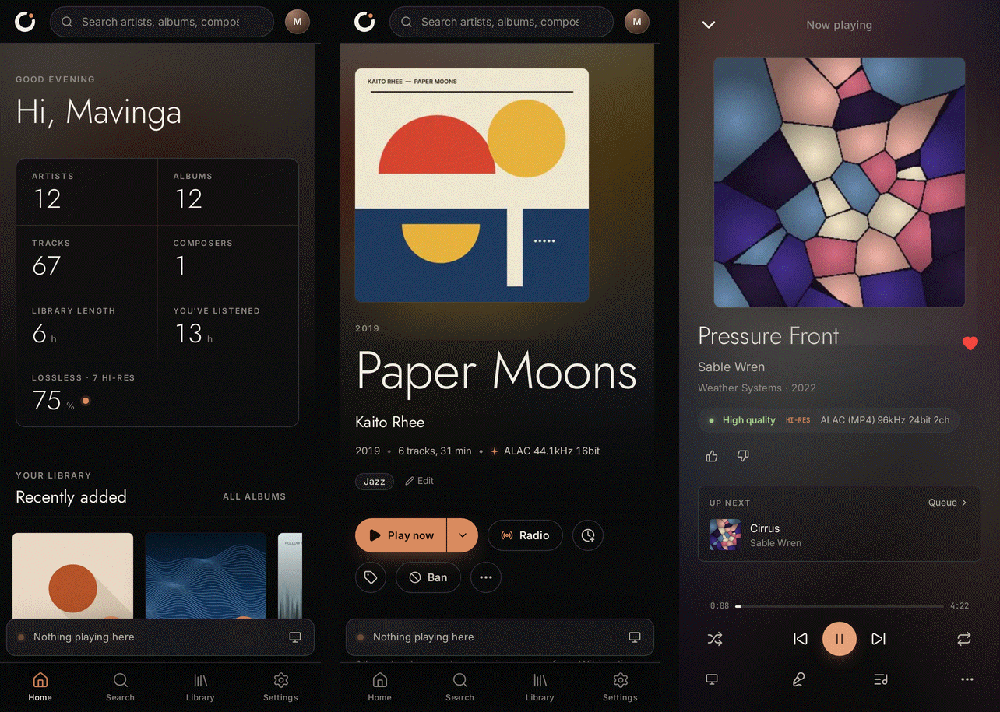

# Mujin Music

Mujin Music is a self-hosted music player for your own collection. You run
the server on a computer, NAS or Raspberry Pi you own, point it at your music
folders, and play from the desktop app, the Android app or any web browser, to
the speakers and DACs around your home.

**Mujin Music is a fork of [Parson](https://github.com/ParsonLabs/Parson) by
ParsonLabs.** Parson's library indexing, accounts, server and web, desktop and
mobile apps are the foundation everything here is built on. See
[Credits](#credits).

The aim of the fork was to take Parson to the level of
[Roon](https://roon.app), the best-known player of this kind, while keeping it
free, open source and entirely on your own hardware.

## What Mujin Music adds to Parson

### Sound and formats

- **Plays every format a collector keeps.** FLAC, ALAC, WAV, AIFF, WavPack,
  Monkey's Audio, TAK, True Audio, DSF and DFF (DSD), MP3, AAC, Ogg Vorbis,
  Opus, Musepack, WMA (including Lossless), Matroska audio, CAF and Wave64.
- **Full quality wherever it plays.** Each player gets the original file when
  it can decode it. Otherwise the server converts it losslessly at the
  file's own rate and depth, and resamples only when a device needs it.
- **DSD** played natively, as DoP, or converted to high-resolution PCM.
- **Signal path with a quality light**, like Roon's. Every step between the
  file and your ears is listed, rated Lossless, Enhanced, High quality or Low
  quality, and the light is honest: shared-mode output and lossy steps are
  not called lossless.
- **Bit-perfect outputs** on the server's own audio devices: exclusive ALSA
  `hw:` on Linux, WASAPI exclusive on Windows, CoreAudio hog mode on macOS.
- **DSP engine on the server**, before the output: headroom, parametric EQ,
  sample-rate conversion, crossfeed, convolution and volume levelling, set
  per zone.

### Zones and speakers

- **Roon-style zones.** Every app, speaker and DAC is a zone. Move the queue
  between zones, group them, set volume limits and sleep timers.
- **Sonos**, spoken to directly on your network, with native sample-synced
  Sonos groups and a signal path for each Sonos zone.
- **UPnP and OpenHome renderers, AirPlay (AirPlay 1) and Chromecast**, all
  driven from the server.
- **Mujin Bridge**: a small program for the computer a DAC is plugged into,
  which turns that DAC into a bit-perfect network zone. Several bridges can
  play as one sample-synced group.

### Browsing and discovery

- **Focus**: stackable filters over the whole library (genre, year, format,
  quality, sample rate, bit depth, credits, label, tags and more), on the
  library and on every person's page.
- **Radio**: endless radio from a song, album, artist or genre, with thumbs
  up and down, skip reasons, and bans for artists, albums and tracks.
- **Credits and works**: performers, conductors, ensembles and composers from
  your tags; compositions grouped into works with form, period and
  instrumentation; composer pages with their full catalogue.
- **Online metadata (off by default)**: biographies, album background,
  reviews, photos, genres and credits from MusicBrainz, Wikidata, Wikipedia,
  Wikimedia Commons and the Cover Art Archive. You choose, field by field,
  whether tags or online data win, and your own edits are never overwritten.
- **Live internet radio** from the community radio-browser.info directory,
  or any station by URL, playable on every zone.
- **Listen Later**, **smart tags** that follow a saved Focus, and a
  **listening history** with statistics and CSV export.

### Streaming services and imports

- **TIDAL and Qobuz** beside your local library: search, browse, add to
  library, and play at the service's best quality. Neither service issues
  keys to this project, so you need your own API credentials (see
  [Known limitations](#known-limitations)).
- **Playlist import from Spotify, Apple Music, YouTube Music, Deezer** and
  from M3U, PLS, XSPF, CSV and iTunes XML files. Tracks are matched to your
  library, with a review screen for uncertain matches. Mujin Music does not
  stream audio from these four services; Spotify can hand playback over to
  Spotify Connect.

### People and accounts

- **Profiles** with quick switching and an optional PIN, so history, likes,
  radio taste and recommendations stay per person.
- **Scrobbling** to Last.fm and ListenBrainz (including a self-hosted
  ListenBrainz), with an offline queue, and history import from both.

### Server, remotes and away from home

- **Server or remote.** On first start the desktop app asks whether to run
  the server on this computer (as a background service that keeps running
  when the window is closed) or to connect to a server elsewhere. Servers are
  found on the network automatically; phones connect with a QR code.
- **Away from home** through Tailscale or another VPN, your own HTTPS address,
  or a router port forward the server can set up itself (UPnP). The server
  checks each route honestly before offering it.
- **Backups and moving house**: scheduled backups to a folder or NAS share,
  and a guided restore that moves a whole library to a new server.
- **Library tools**: skipped files with the exact reason and a fix,
  duplicates (including acoustic fingerprints), album versions, an
  Albumizer for loose tracks, rescans and loudness analysis as background
  jobs. None of them touch your music files.

### Home Assistant

- A **Home Assistant integration** (domain `mujin_music`, installable with
  HACS) that makes every zone a media player, with browsing, search, radio,
  thumbs, grouping and transfer. It pairs with a six-digit code and talks to
  your server directly, never through a cloud.

### Look and packaging

- **The Mujin Music identity**: the Ensō Signal logo (whose dot follows the
  quality light), the Mujin Copper accent, and the Jost, Inter and JetBrains
  Mono fonts.
- **A gallery-style redesign**: large album art, a blurred-art Now Playing
  with the quality light and Up next, album pages with release details,
  credits, biographies and reviews (from MusicBrainz and Wikipedia when
  online metadata is on), timed lyrics read from your files (embedded LRC,
  ID3 SYLT/USLT or an `.lrc` beside the track), and a full-screen display
  mode for TVs and tablets that follows a zone.
- **A theme engine**: six presets (Mujin Dark, Mujin Light, Material You,
  Frosted Glass, OLED Black and High Contrast), an accent picker that checks
  every colour against WCAG contrast and corrects it, colour from the playing
  album's artwork, corner radius, text size, density, reduced motion and
  transparency, Now Playing layouts and Home rows. Material You follows
  Android 12+ wallpaper colours on the phone; Frosted Glass uses Mica or
  Acrylic on Windows and vibrancy on macOS in the desktop app, with a plain
  fallback where the system has none. Appearance is saved to your profile and
  reaches your other open sessions at once.

|  |  |
| -------------------------------------- | -------------------------------------- |
|              |              |
|              |    |

The library in these captures is a demo library with generated cover art and
fictional artists.

- **Windows installer** that adds Windows Firewall rules for private
  networks (so phones and speakers can reach the server) and shows Mujin
  Music in Windows' media controls and on the media keys.
- **Android app** built as an APK by CI on every change.

## How it was built and tested

The fork was built in focused rounds, one area at a time (formats, signal
path, zones, radio, Focus, metadata, streaming, Home Assistant, server and
remotes, and so on). Most of the code was written by Claude, Anthropic's AI
model, working in Claude Code at the owner's direction; the commits say so.

- **The bar was Roon's public material.** For each area, Roon's published
  documentation and screenshots set the standard. The finished feature and
  Roon's equivalent were then compared blind, without saying which was
  which, and the area was reworked until it came out ahead. Sound and
  formats, zones, browsing and radio, streaming and imports, profiles and
  scrobbling, the server and remote access, library tools and Home Assistant
  all did. The depth of credits and metadata is still behind Roon. These
  were comparisons against Roon's public material, not side-by-side tests
  with a running copy of Roon.
- **Hardware and paid accounts were tested against fakes.** No real Sonos
  speaker, AirPlay or Chromecast device, UPnP renderer, router, USB DAC or
  paid TIDAL or Qobuz account was available. Each was replaced by a
  protocol-level fake that speaks the real protocol (a fake Sonos household,
  a fake AirPlay receiver, a fake Cast device, simulated DACs, recorded TIDAL
  and Qobuz replies and so on). The ALSA output was also run through the real
  libasound. These tests show the protocols are followed; they do not prove
  every real device behaves the same way.
- **Every change runs the full test suite in CI**: Rust tests and lints,
  JavaScript and SDK tests, desktop and mobile build checks, the Home
  Assistant integration's tests, CodeQL, dependency audits for Rust and
  JavaScript, and a container scan.

## Everything is self-hosted

- The server, your library, accounts, playlists, history and recommendations
  all live on hardware you control.
- There is no Mujin Music cloud and no account to create with anyone. No
  analytics or crash reports are sent.
- The server only contacts outside services you choose to use: lyrics,
  online metadata (off until an administrator turns it on), live radio
  stations and their directory, TIDAL or Qobuz if you sign in, the playlist
  services you connect, Last.fm or ListenBrainz if you connect them, and the
  desktop app's update check against this repository's releases.

## Install

Builds are published on this repository's
[Releases page](https://github.com/mavingaw/Mujin-Music/releases) when a
version is tagged.

- **Windows**: run `Mujin-Music-Setup-<version>-<arch>.exe`. It installs the
  app and can run the server in the background. A server-only download
  (`ParsonMusicServer.exe`, with Windows Firewall helpers) is also built for
  PCs without a screen.
- **macOS and Linux**: desktop packages are published beside the Windows
  installer.
- **Android**: the APK is built by the
  [Android workflow](../.github/workflows/android.yml) and attached to each
  run as `mujin-music-android-arm64-v8a`. A 32-bit (`armeabi-v7a`) build can
  be started by hand from the Actions tab.
- **Docker**: the server image is `ghcr.io/mavingaw/mujin-music`, published
  for x86_64 and arm64 with each release.
- **Server only**: Docker, systemd on Linux, or the Windows server. See the
  [server guide](server.md).
- **Home Assistant**: add this repository to HACS as a custom integration.
  See the [integration's README](../custom_components/mujin_music/README.md).

The user guide is in [apps/site/content/docs](../apps/site/content/docs).

## Coming next

These are being worked on and are **not** in the current code yet:

- **FETCH**: finds better (lossless) versions of music you already have.
- **Apollo**: a self-hosted AI enhancer.

## Known limitations

- **Credits and metadata are still behind Roon.** Roon licenses editorial
  metadata; Mujin Music relies on your tags and on free sources (MusicBrainz,
  Wikidata, Wikipedia), so credits and reviews are thinner for many albums.
- **Not yet tried on real hardware.** Sonos, AirPlay, Chromecast, UPnP,
  bridges, exclusive-mode DACs and router port forwarding were tested against
  fakes and simulators, not real devices. Please report what works and what
  doesn't.
- **TIDAL and Qobuz need your own API credentials** (a TIDAL client, a Qobuz
  app id and secret). None are shipped and none are taken from the services'
  apps. Playback has not yet been verified against a live paid account.
- **Spotify, Apple Music, YouTube Music and Deezer are imports only**, not
  audio streaming. Spotify needs your own client id; Apple Music needs a
  developer token.
- **AirPlay 2-only speakers are not supported**; AirPlay 1 receivers are.
- **No iOS build yet.** CI builds the Android app only.
- **Internal names still say "parson"** (crate names, `PARSON_*` settings,
  data folders, the `_parson._tcp` network service), so existing installs and
  merges from upstream keep working.

## Credits

### Parson by ParsonLabs

Mujin Music is a fork of **[Parson](https://github.com/ParsonLabs/Parson)** by
**ParsonLabs**, licensed under the GNU General Public License version 3 only
(GPL-3.0-only). The foundation of Mujin Music (library indexing, accounts, the
server, and the web, desktop and mobile apps) is their work. Mujin Music keeps
Parson's licence and copyright notices, and is distributed under the same
GPL-3.0-only licence.

Parson contributors, from the upstream history up to the point this fork
branched:

- WillKirkmanM

### Roon

Roon's public documentation and screenshots were the bar each feature was
measured against. Roon is a trademark of Roon Labs; Mujin Music is not
affiliated with or endorsed by Roon Labs.

### Fonts

Jost, Inter and JetBrains Mono, and the fonts offered in Settings → Appearance
(Fraunces, Atkinson Hyperlegible Next, IBM Plex Sans and Roboto Flex), each
under the SIL Open Font License 1.1. Each font folder in
`apps/web/public/fonts` carries its `OFL.txt`.

### Libraries

Mujin Music is built on many open-source projects, each under its own
licence. The main ones:

- **Server**: Rust, actix-web, Tokio, Diesel and SQLite, lofty and id3 (tag
  reading), reqwest and rustls, mdns-sd, image, notify, rayon, argon2.
- **Apps**: Next.js, React, Radix UI, TanStack Query, Tailwind CSS, Lucide,
  Electron with electron-builder and electron-updater, Expo and React Native,
  react-native-audio-api, react-native-google-cast, Fumadocs for the docs.
- **Audio tools**: FFmpeg (decoding, conversion and resampling) and,
  optionally, Chromaprint's `fpcalc` for fingerprints.

Exact versions are in `Cargo.lock` and `bun.lock`. Packages ship a
`THIRD_PARTY_NOTICES.md` generated by
[tools/generate-third-party-notices.cjs](../tools/generate-third-party-notices.cjs);
the Android app's notices are in
[apps/mobile/THIRD_PARTY_NOTICES.md](../apps/mobile/THIRD_PARTY_NOTICES.md).

### Services

Used only when you turn them on or connect them: MusicBrainz, Wikidata,
Wikipedia and Wikimedia Commons (text and photos shown with their
Creative Commons attribution), the Cover Art Archive, LRCLIB (lyrics),
radio-browser.info, Last.fm, ListenBrainz, TIDAL, Qobuz, Spotify, Apple Music,
YouTube and Deezer. All names are trademarks of their owners; Mujin Music is
not affiliated with any of them.
